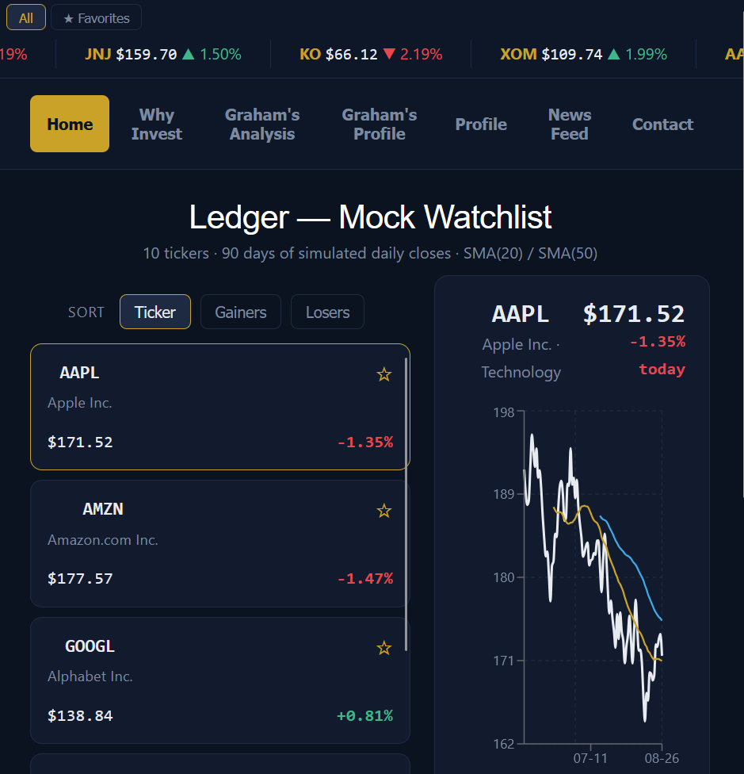
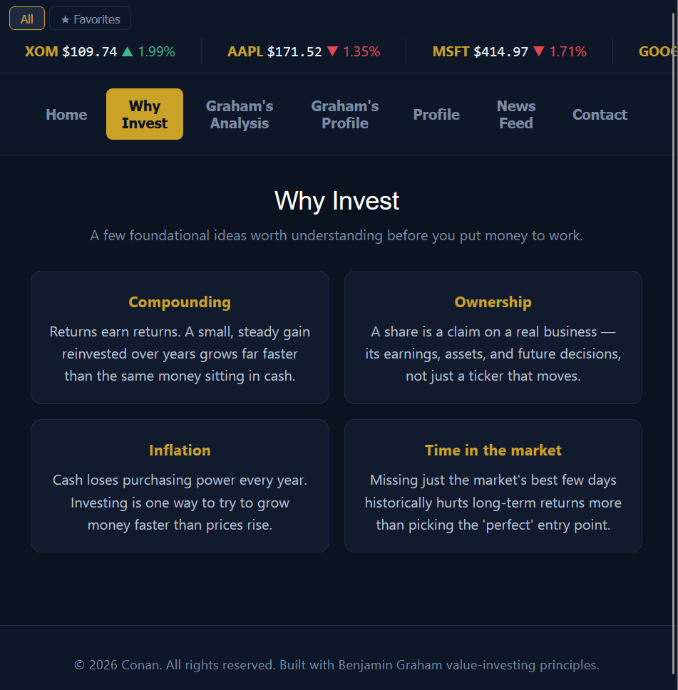
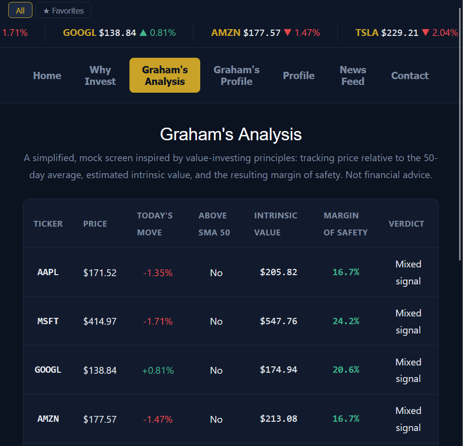
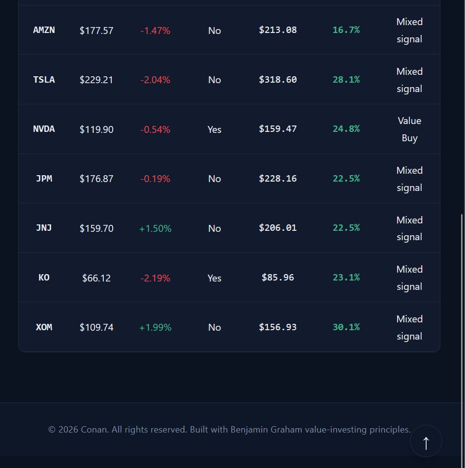
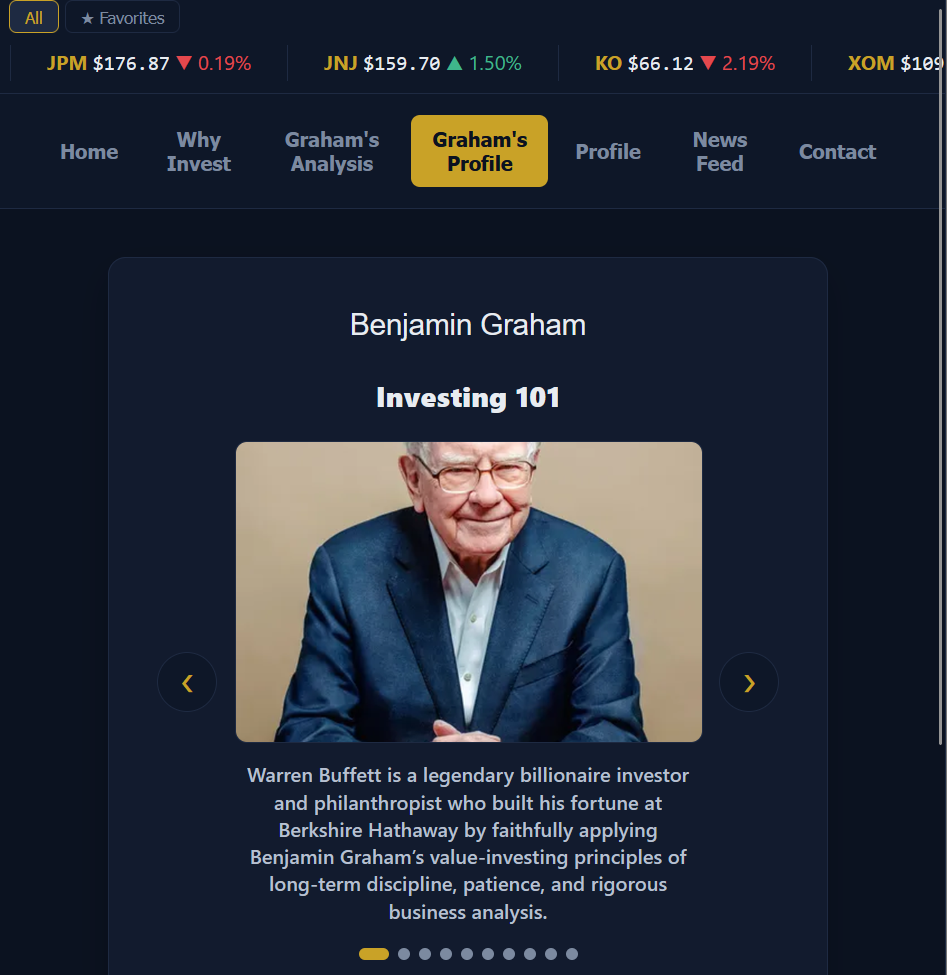
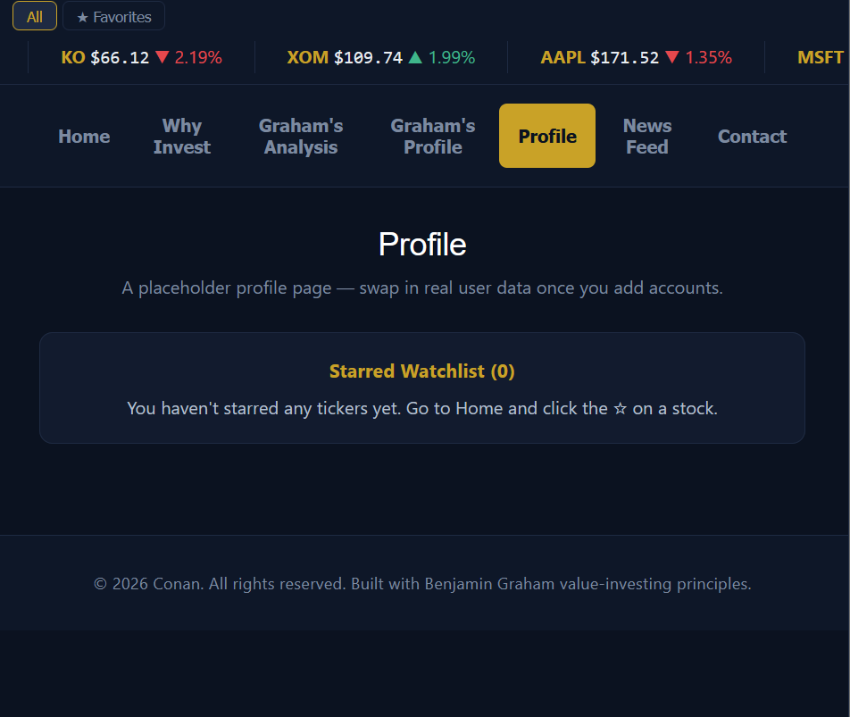
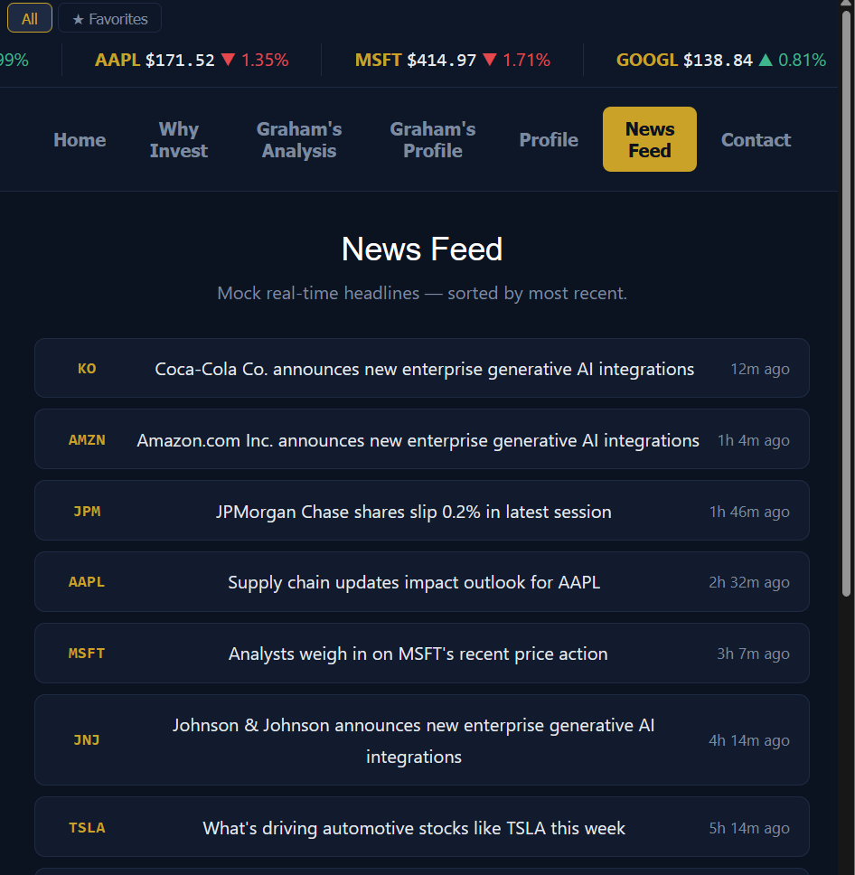
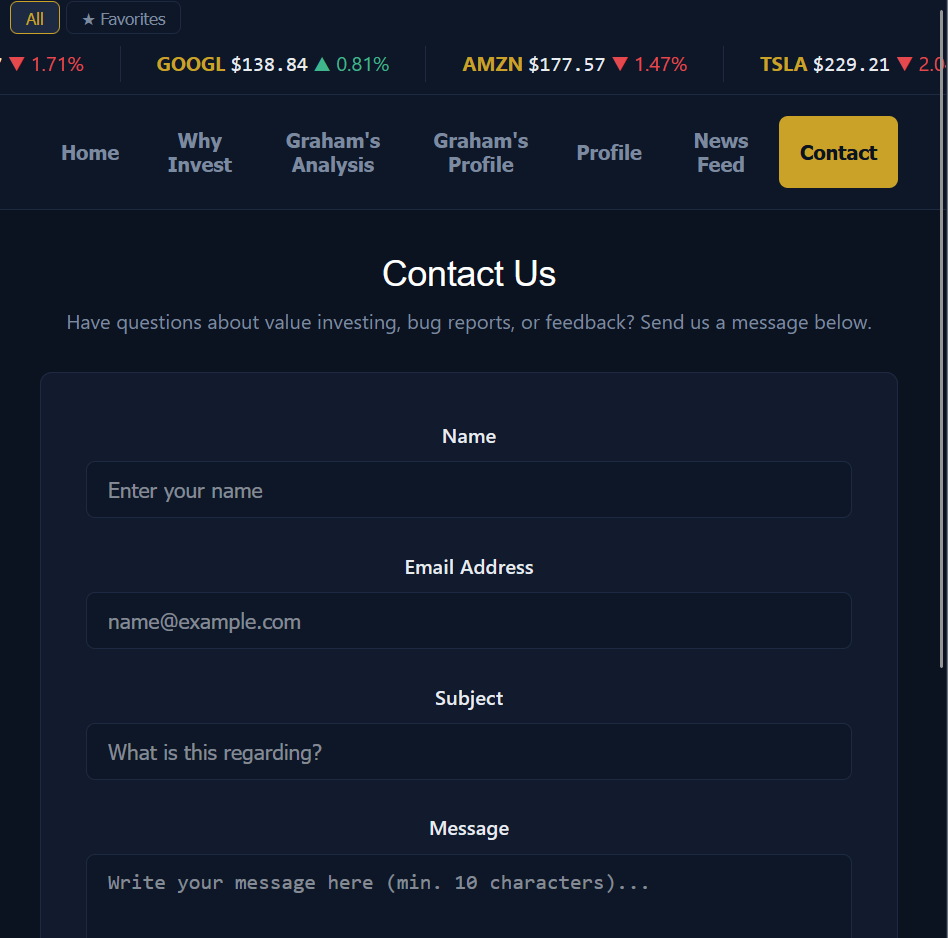
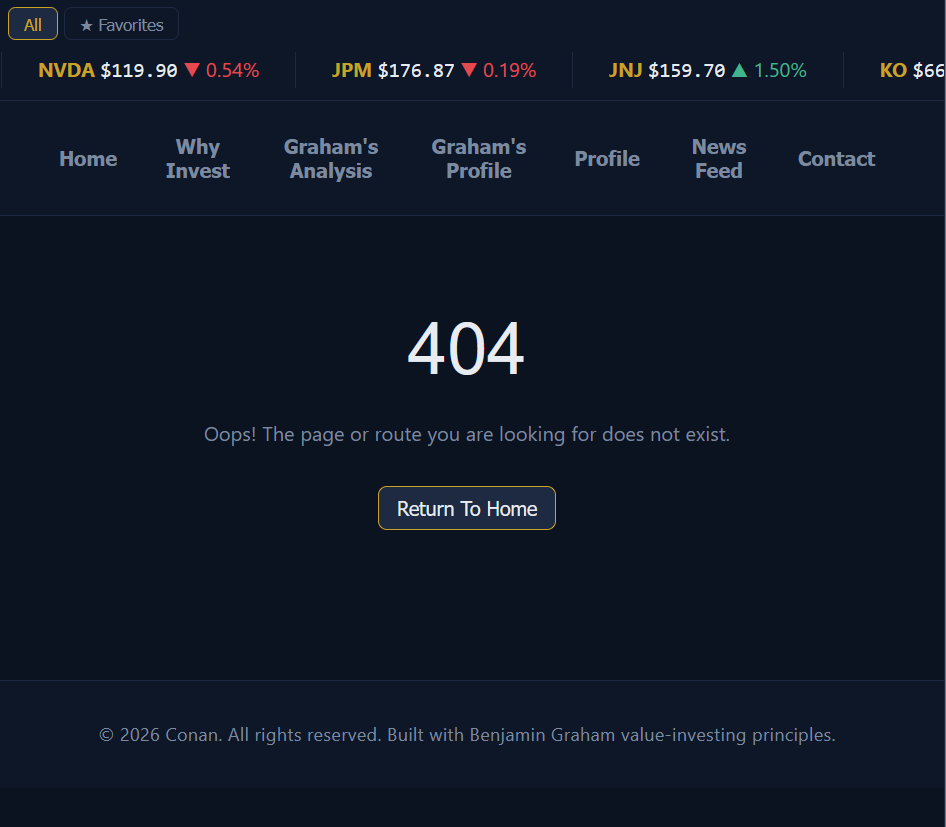

<h1> 📈 Benjamin Graham Stock Analyzer </h1>

<h3> 📝 <u> Project Description </u></h3>

The Benjamin Graham Stock Analyzer is a React-based web applicaiton designed to help investors evaluate stocks using Benjamin Graham's timeless principles. This app calculates the intrinsic value, tracks watchlists, updates market news and provide graphical analysis of the stock that the user is interested in. It helps the users make sound, defensive investment decisions.

<h3> 🚀 <u> Technologies Used </u></h3>

Frontend: React (Hooks: useState, useMemo, useState)
 
Styling: CSS / Modern Flexbox & Grid

State Management: React component state & native set objects for watchlists

Tooling: Vite

<h3> 🛠️ <u> Setup and Installation </u> </h3>

Instructions:
1. Clone the repository:
```bash
git clone https://github.com/your-username/your-repo-name.git
```
2. Navigate to the project directory: 
```bash 
cd your-repo-name
```
3. Install dependencies:
```bash
npm install
```
4. Run the development server: 
```bash
npm run dev
```
5. Open your browser:
Navigate to http://localhost:5173 (or the port you specified in your terminal)


<h3> 📊 <u> Fundamentals Screener (real data) </u></h3>

The **Screener** page scores real US companies against your own rules, using free data only:

| What | Source | Key needed? |
| --- | --- | --- |
| Annual financials (revenue, EPS, balance sheet, cash flow, dividends) | [SEC EDGAR XBRL API](https://www.sec.gov/search-filings/edgar-application-programming-interfaces) | No |
| Prices (5 years, weekly closes) | [Defeat Beta](https://huggingface.co/datasets/defeatbeta/yahoo-finance-data) bulk file on Hugging Face (ODC-BY, Yahoo Finance data, updated about daily); Yahoo / Stooq only for symbols it lacks | No |

GitHub Pages can't call these APIs from the browser (no CORS, and SEC needs a User-Agent header), so the app reads a
**static snapshot** in `public/data/<market>/` (git-ignored, never committed). The *Refresh market data* GitHub Action
rebuilds it every Monday (or on demand from the Actions tab) and deploys it with the site.

**Run it yourself (one command):**

```bash
cp .env.example .env        # then put your name and email in it (SEC requires this)
npm run fetch:us            # every NYSE / Nasdaq / Cboe company (~6,000)
npm run dev                 # open the Screener
```

All company data comes from the zips; the only other SEC request is one small ticker list that maps tickers to companies.
`fetch:us` downloads SEC's two nightly bulk files (`companyfacts.zip` and `submissions.zip`, about 2.5 GB together),
reads each company's JSON straight out of the zips one at a time (nothing is extracted, memory stays low), writes a
compact `index.json` for the screener plus one small file per company that loads only when you open it, then deletes the
zips. Prices come from one ~470 MB file, `stock_prices.parquet` from Defeat Beta, read with DuckDB (memory capped at
1 GB, 2 threads) and deleted afterwards. Only symbols missing from it are asked from Yahoo, 20 per request
(`--no-yahoo` skips that). A failed run leaves the previous snapshot in place.

| Command | What it does |
| --- | --- |
| `npm run fetch:us` | All listed companies, with prices |
| `npm run fetch:us -- --no-prices` | All companies, financials only (fast, but price-based ratios are blank) |
| `npm run fetch:us -- --zip-dir /path/to/folder` | Use `companyfacts.zip`, `submissions.zip` and/or `stock_prices.parquet` you already downloaded (or set `SEC_ZIP_DIR` in `.env`); they are never deleted |
| `npm run fetch:us -- --no-yahoo` | Prices only from the Defeat Beta file; no Yahoo requests at all |
| `npm run fetch:us -- --keep-zips` | Keep the downloads in `.cache/sec/` so another run today skips them |
| `npm run fetch:us:quick` | Just the watchlist in `scripts/markets/us.tickers.json` (a minute or two) |
| `npm test` | Unit tests for parsers, metrics and rules |

- **Foreign companies:** 20-F / 40-F filers (e.g. TSMC, ASML) are included, read from IFRS or US GAAP data and
  converted to USD at each year-end rate (Defeat Beta `exchange_rate.parquet`). Their price ratios (P/E, P/B, intrinsic
  value) are left blank, because one US-listed share (often an ADR) can stand for several home-market shares.
- **SEC contact (required):** SEC refuses requests (HTTP 403) that don't name who is asking. Locally, set
  `SEC_USER_AGENT="Your Name you@example.com"` in `.env` (git-ignored). For the GitHub Action, add the same value as a
  repository variable: Settings → Secrets and variables → Actions → Variables → `SEC_USER_AGENT`.
- **Fair use:** two bulk downloads replace thousands of SEC API calls; SEC API calls in quick mode stay under their 10/second limit.
- **Your rules:** the *My Rules* page starts with Graham's seven defensive-investor tests. Change thresholds, switch rules on or
  off, or add rules on any metric. They are saved in your browser.

**Data layer.** Each market is registered in `scripts/markets/index.mjs` with a fundamentals provider and a list of price
sources. Every provider returns the same shape (`fiscalYears: [{ fiscalYear, periodEnd, revenue, netIncome, epsDiluted, … }]`),
so the app does not care where the numbers came from. Adding Singapore means writing an SGX fundamentals provider
(prices already work through Yahoo with `.SI` tickers) and enabling the market in `src/final_project/data/markets.js`.

<h3> 🌐 <u> Live Demo </u></h3>

🚀 Check out the live deployment of the application here 🚀:
<p align="center">
  <a href="http://localhost:5173/" target="_blank">
    <p>👉  Click Here to View Live Demo </p>
  </a>
</p>

<h3> 📸 <u> Screenshots </u></h3>

| <div align="center"> <br><h3><strong>Home Page</strong></h3></div> | <div align="center"> <br><h3><strong>Why do we invest?</strong></h3></div> |
| :---: | :---: |
| <div align="center"> <br><h3><strong>Graham's Analysis</strong></h3></div> | <div align="center"> <br><h3><strong>Showcasing the scroll to top button</strong></h3></div> |
| <div align="center"> <br><h3><strong>Graham's Profile</strong></h3></div> | <div align="center"> <br><h3><strong>User's profile</strong></h3></div> |
| <div align="center"> <br><h3><strong>News Feed</strong></h3></div> | <div align="center"> <br><h3><strong>Contact Us</strong></h3></div> |
| <div align="center"> <br><h3><strong>Error page</strong></h3></div> 
